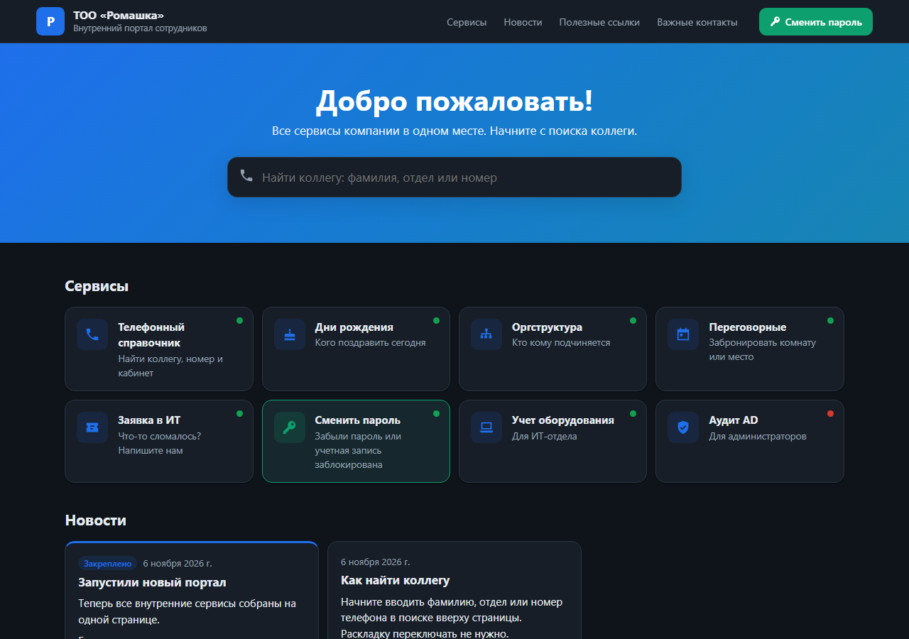

# AD Tools — внутренние сервисы для компаний с Active Directory

Серия самостоятельных сервисов, которые разворачиваются на сервере компании и работают
с её Active Directory: без публикации в интернет, без облаков и внешних CDN. Каждый сервис
ставится отдельно, а [AD Portal](#портал-и-установка) собирает их на одной странице.

> **Исходный код закрыт и выдаётся по запросу.** Репозитории приватные. Чтобы получить
> доступ, [оставьте запрос](../../issues/new?template=access-request.yml): укажите логин
> GitHub, компанию и какие сервисы нужны. Доступ выдаётся вручную, обычно в течение
> нескольких рабочих дней.

## Сервисы

| Сервис | Что делает |
|---|---|
| **ad-phonebook** | Телефонный справочник из AD: поиск по ФИО, отделу и номеру, исправление раскладки |
| **ad-phonebook-lite** | Справочник в один HTML-файл — один скрипт PowerShell без установки |
| **ad-birthdays** | Дни рождения и годовщины работы: страница и утренняя рассылка |
| **ad-orgchart** | Интерактивная оргструктура по полю `manager` |
| **ad-absence** | Отпуска, отсутствия и замещения; статус виден в справочнике и оргструктуре |
| **ad-rooms** | Бронирование переговорных и рабочих мест, экран-киоск у переговорной |
| **ad-helpdesk** | Заявки в ИТ: роли по группам AD, SLA, отчёты |
| **ad-inventory** | Учёт ИТ-оборудования, связь с компьютерами в AD |
| **ad-onboarding** | Приём и увольнение по шаблонам должностей, заявки и выдача техники |
| **ad-access** | Запросы доступа к группам с одобрением владельцем и пересмотром |
| **ad-sspr** | Смена и сброс пароля, разблокировка учётки без звонка в ИТ (MFA/TOTP) |
| **ad-laps** | Просмотр паролей локальных администраторов (LAPS) с журналом |
| **ad-certs** | Сроки TLS-сертификатов во внутренней сети и в AD CS |
| **ad-polls** | Опросы и голосования, честный анонимный режим |
| **ad-audit** | Аудит безопасности AD: риск и команда для исправления |
| **ad-toolkit-lite** | Скрипты PowerShell: подпись Outlook, vCard, отчёты по группам, GPO и NTFS, напоминания о пароле, чистка неактивных учёток |

## Портал и установка

| Компонент | Что делает |
|---|---|
| **ad-portal** | Стартовая страница компании: плитки сервисов, поиск коллег, «Сегодня», статус сервисов, редактор без кода |
| **ad-tools-suite** | Установка всей серии за раз: один файл настроек, Docker с Caddy и HTTPS, Windows, Linux |
| **ad-tools-core** | Общее ядро: LDAP с отказоустойчивостью, вход, сессии, вход через Kerberos (SSO) |
| **ad-testlab** | Стенд Samba AD: каждый сервис проверяется на настоящем контроллере домена в CI |

## Общее

- Node.js 20.12+ (часть сервисов — 22+), единственная зависимость — `ldapts`; Lite-версии — PowerShell 5.1.
- Вход по паролю домена с проверкой группы AD; вход через Kerberos (проверен на Samba AD).
- Интерфейс на русском и казахском.
- Служба Windows, systemd или Docker; подробная пошаговая инструкция в каждом репозитории.
- Лицензия GPL-3.0.

## Как запросить доступ

1. Откройте [форму запроса](../../issues/new?template=access-request.yml).
2. Укажите логин GitHub, компанию, нужные сервисы и для чего они.
3. Когда доступ выдан, GitHub пришлёт приглашение на почту вашего аккаунта — его нужно принять.

Вопросы по серии — тоже через [Issues](../../issues) этого репозитория.
